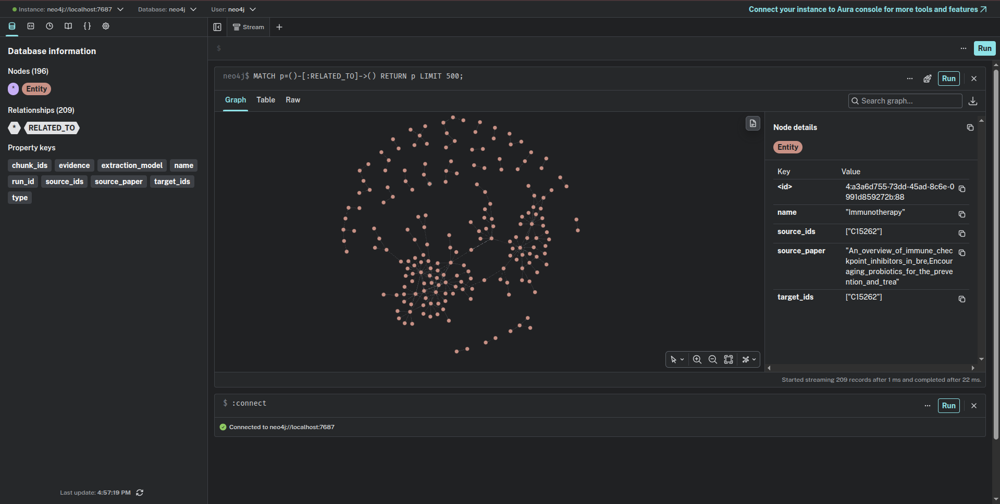
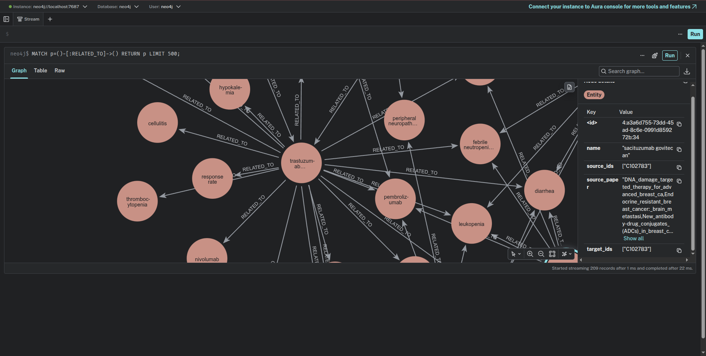
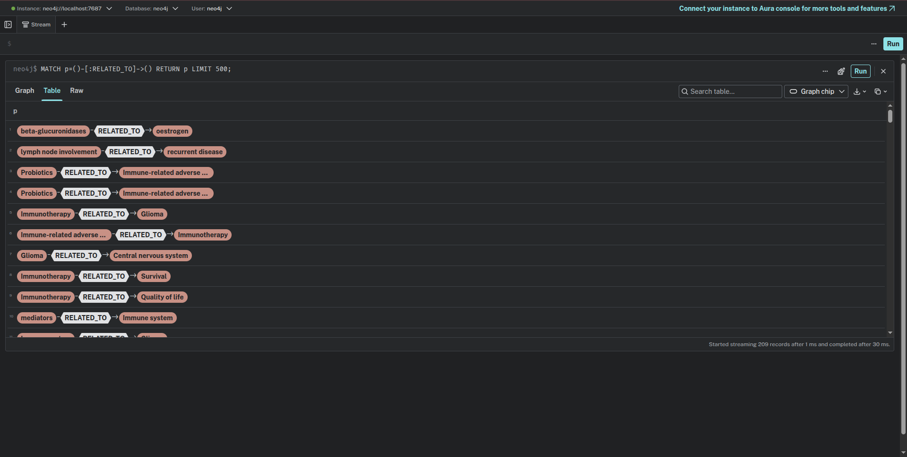
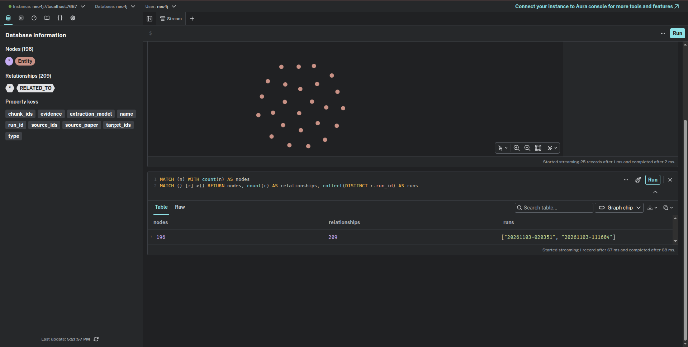

# Agent-driven Biomedical Knowledge Graph

An end-to-end agentic pipeline that automatically extracts biomedical knowledge from scientific literature and stores it as a queryable knowledge graph. The system processes research papers through a 6-step modular pipeline — from raw PDF cleaning to structured Neo4j graph storage — and exposes an interactive natural language QA interface with full source attribution and NCIt ontology traceability.

---

## Demo

```
🧠 Welcome to the Biomedical Knowledge Graph Pipeline
1. Run full pipeline
2. Go directly to QA
3. Exit
Select an option (1/2/3): 2

🔍 Launching interactive QA system...
Choose QA model backend ('ollama', 'openai', or 'gemini'): gemini
✅ Successfully connected to Neo4j

🔎 Starting QA Session with GEMINI (type 'exit' to end)

Question: what is breast cancer

✅ Gemini responded using model: gemini-2.5-flash

💡 Breast cancer is a manifestation of:
- malignancies [source: New_antibody-drug_conjugates_(ADCs)_in_breast_canc]
- malignancy [source: DNA_damage_targeted_therapy_for_advanced_breast_ca]

It is associated with:
- altered gut microbiota [source: Does_the_gut_microbiome_environment_influence_resp]
- germline mutations in BRCA1/2 gene [source: DNA_damage_targeted_therapy_for_advanced_breast_ca]
- hereditary forms [source: DNA_damage_targeted_therapy_for_advanced_breast_ca]

Breast cancer can be diagnosed by:
- Infrared breast thermography [NCIT IDs: C62663] [source: Development_and_validation_of_an_infrared-artifici]
- infrared-artificial intelligence software [source: Development_and_validation_of_an_infrared-artifici]

Breast cancer predisposes to:
- brain metastasis [source: Endocrine_resistant_breast_cancer:_brain_metastasi]

Question: What drugs target both breast cancer and diabetes?
💡 This information is not in the knowledge graph.
```

Every answer is grounded in the knowledge graph — the system cites the exact source paper and NCIt ontology ID for each relationship. When information is absent, it says so honestly rather than hallucinating.

---

## Pipeline Architecture

```
PDF Papers
    │
    ▼
┌─────────────────────┐
│  1. PDF Cleaning     │  Remove noise, headers, references
└─────────┬───────────┘
          │
          ▼
┌─────────────────────┐
│  2. NER Agent        │  BioBERT — extract genes, diseases,
│                     │  drugs, proteins, mutations
└─────────┬───────────┘
          │
          ▼
┌─────────────────────┐
│  3. Entity Cleaning  │  Normalize and deduplicate entities
└─────────┬───────────┘
          │
          ▼
┌─────────────────────┐
│  4. Relation         │  LLM agents — extract causal
│     Extraction       │  relationships between entities
└─────────┬───────────┘
          │
          ▼
┌─────────────────────┐
│  5. Ontology         │  NCIt validation — verify entities
│     Validation       │  against NCI Thesaurus, assign IDs
└─────────┬───────────┘
          │
          ▼
┌─────────────────────┐
│  6. Neo4j Storage    │  Persist graph + expose QA interface
│     + QA             │  with citation tracking
└─────────────────────┘
```

---

## Key Features

- **Multi-LLM backend** — switch between Ollama (local), OpenAI GPT-4o, and Google Gemini at runtime with automatic fallback model selection
- **Transformer-based NER** — BioBERT extracts biomedical entities (genes, diseases, drugs, proteins, mutations, pathways) from raw text
- **Causal relationship extraction** — LLM agents identify typed relationships between entity pairs across 9 research papers
- **NCIt ontology validation** — every extracted entity is validated against the NCI Thesaurus before graph storage, reducing LLM hallucinations
- **Source-attributed QA** — each answer surfaces the supporting paper filename and NCIt ontology ID for full reproducibility
- **Honest grounding** — returns "This information is not in the knowledge graph" rather than hallucinating answers
- **Resource-efficient** — supports quantized local models (`llama3.2:3b` via Ollama) for consumer hardware, with cloud fallback
- **Robust Neo4j connection** — automatic reconnection on idle dropout via Neo4j Aura

---

## Results

Evaluation graph built on 2026-11-03 with `gemini-2.5-flash` (temperature 0, `maxOutputTokens` 65536), core entity `breast cancer`, NER model `d4data/biomedical-ner-all`, stored in a local Neo4j 5.26 Community instance. It was produced by two runs: `20261103-020351` covers 7 papers, and `20261103-111604` re-ran the 2 papers that hit Gemini rate limits (`--papers`). Full logs are in `runs/<run_id>/`.

| Metric | Value |
|---|---|
| Papers processed | 9 / 9 |
| NER entities (raw → after rule-based cleaning) | 11,162 → 2,853 |
| Candidate entities sent to NCIt (relation endpoints, unique per paper) | 980 |
| Accepted / rejected by NCIt | 364 (218 exact, 146 fuzzy) / 616 |
| Relations extracted by the LLM | 913 (163 distinct relation types) |
| Relations with both entities grounded in NCIt (stored) | 211 |
| Relations with a supporting sentence found in the source text | 365 of 913; 93 of the 209 stored edges |
| **Final Neo4j graph** | **196 nodes, 209 relationships, 48 relation types** |

Per paper:

| Paper | NER final | Candidates | Accepted | Relations | Stored |
|---|---:|---:|---:|---:|---:|
| An overview of immune checkpoint inhibitors in breast cancer | 346 | 51 | 20 | 30 | 8 |
| DNA damage targeted therapy for advanced breast cancer | 385 | 150 | 56 | 123 | 29 |
| Development and validation of an infrared-AI software for breast cancer detection | 179 | 33 | 8 | 32 | 2 |
| Does the gut microbiome environment influence response to systemic breast cancer treatment? | 245 | 59 | 21 | 40 | 5 |
| Downregulation of 15-hydroxyprostaglandin dehydrogenase during acquired tamoxifen resistance | 334 | 52 | 8 | 38 | 0 |
| Encouraging probiotics … immunotherapies against malignant glioma | 254 | 208 | 86 | 243 | 57 |
| Endocrine resistant breast cancer: brain metastasis | 227 | 192 | 63 | 178 | 22 |
| Immune checkpoint inhibitors in triple negative breast cancer treatment | 604 | 123 | 41 | 72 | 11 |
| New antibody-drug conjugates (ADCs) in breast cancer | 279 | 112 | 61 | 157 | 77 |

The most-connected nodes are trastuzumab deruxtecan (21 edges), sacituzumab govitecan (16), ladiratumab vedotin (13), immunotherapy (13) and immune-related adverse events (13).

Each run directory contains `config.json` (settings, papers, model actually used, finish reason and token usage per paper), `relations.jsonl` (one line per extracted relation with its provenance and validation outcome), `entity_validation.jsonl` (one line per NCIt candidate) and `summary.json`. Every Neo4j relationship carries `source_paper`, `run_id`, `chunk_ids`, `evidence` and `extraction_model`.

### Knowledge graph in Neo4j

Screenshots from Neo4j Browser of the evaluation graph described above.

**Full graph:** 196 `Entity` nodes and 209 `RELATED_TO` relationships. The sidebar lists the provenance property keys stored on the graph (`chunk_ids`, `evidence`, `extraction_model`, `run_id`, `source_paper`).



**Close-up:** trastuzumab deruxtecan, the most-connected node, linked to the adverse events and comparator drugs reported in the ADC paper.



**Relations as a table:** extracted source → target pairs, e.g. probiotics → immune-related adverse events and immunotherapy → glioma.



**Counts check:** 196 nodes and 209 relationships, all produced by the two evaluation runs (`20261103-020351`, `20261103-111604`).



**Video walkthrough** (3:47) of browsing the graph in Neo4j Browser:


https://github.com/user-attachments/assets/c936441c-0404-4f2c-8dec-6eb311de7670


---

## Findings

- **Output-token truncation was the main bottleneck.** With `maxOutputTokens` 8192, every Gemini response was cut off: gemini-2.5-flash spends 11k–34k "thinking" tokens per paper, and these count against the same budget. That run (`runs/20261102-205306`) recovered only 75 relations and 10 graph edges. Raising the limit to 65536 gave 913 relations and 209 edges, and every response ended with `finishReason: STOP`.
- **NCIt validation grounds entities, not relations.** 211 relations were stored because both endpoints resolved to NCIt concepts, but none of the 913 matched an NCIt relationship between those concepts (`requested_relation_found` is false for every relation). Stored edges are therefore LLM claims about grounded entities, not ontology-confirmed facts.
- **Fuzzy matching accounts for 40% of accepted entities** (146 of 364, `rapidfuzz` ratio ≥ 85). Many look right (e.g. "PARP inhibitors" → C155926), but near-miss matches such as "homologous recombination repair reactivation" → C150641 need manual review.
- **The LLM mostly names its own entities.** Only 265 of the 980 NCIt candidates (27%) appear verbatim in that paper's cleaned NER entity list. The NER output works as a hint in the prompt, not as a constraint.
- **Relation types are not controlled.** The prompt lists about 25 preferred types, but the model produced 163 distinct ones (e.g. `is_a_type_of`, `improves`, `lacks`). The stored graph has 48.
- **Evidence coverage is partial.** The extractor does not return evidence, so supporting sentences are found afterwards by looking for a sentence that mentions both entities. This works for 40% of all relations and 44% of stored edges. A missing sentence does not mean the relation is unsupported, because the model often paraphrases entity names.
- **Graph integration across papers is weak.** Only 2 of 209 edges are supported by more than one paper. Six groups of nodes differ only by capitalisation (e.g. `Immunotherapy` / `immunotherapy`), because nodes are merged on the exact name.
- **The paper set is not purely breast cancer.** The probiotics paper is about malignant glioma and never mentions breast cancer. The model correctly extracted no breast-cancer relations from it, even though the prompt asks for at least one relation involving the core entity. It is also the largest contributor (243 relations, 57 stored edges).
- **Output is uneven across papers.** One paper (15-PGDH / tamoxifen resistance) contributed no edges, and two papers (ADCs and probiotics) account for 64% of stored relations (134 of 211).
- **Rate limits dominate run time.** The 7-paper run took 50 minutes, mostly waiting on HTTP 429/503 retries. Two papers failed after exhausting retries, and the fallback models (`gemini-2.0-flash`, `gemini-1.5-*`) are no longer available.

---

## Evaluation Plan

1. **Relation precision (manual annotation).** Sample about 100 stored edges, stratified by paper and relation type. Have two annotators label each against the source paper as *supported*, *partially supported* or *unsupported*, using the `evidence` sentences where present. Report precision with 95% confidence intervals and inter-annotator agreement (Cohen's κ).
2. **Entity grounding accuracy.** Sample about 100 accepted entities from `entity_validation.jsonl`, split evenly between exact and fuzzy matches, and check whether the assigned NCIt concept is correct. Use this to choose a fuzzy threshold, or to drop fuzzy matching.
3. **Rejection analysis.** Sample about 100 rejected entities and classify why they failed (not a biomedical concept, phrase too long or compositional, a synonym missing from the index, or a normalisation issue). Estimate how many valid relations validation discards.
4. **Evidence coverage.** For relations without a matched sentence, check whether the relation is still stated in the text. This shows whether the post-hoc matcher under-reports support and whether evidence should be requested from the LLM directly.
5. **Recall on a gold subset.** Annotate all relations in 2 papers by hand (one breast-cancer review, plus the glioma paper as an off-topic control). Report recall and precision of extracted relations before and after NCIt filtering.
6. **Reproducibility.** Re-run the pipeline 3 times with identical settings and measure the overlap (Jaccard) of stored edges. Temperature 0 does not guarantee identical outputs from Gemini's thinking models.
7. **Ablations.** Compare 8192 vs 65536 output tokens (already logged), with vs without fuzzy matching, and gemini-2.5-flash vs an alternative backend (`--backend openai`). Use the same papers and core entity, and report the metrics above for each.
8. **Downstream QA.** Write about 30 questions answerable from the papers. Score QA answers for correctness and source attribution, and check that unanswerable questions return the "not in the knowledge graph" response.

To reproduce the run: `python main_pipeline.py --mode full --backend gemini --core-entity "breast cancer" --clear-neo4j`. To re-run individual papers without clearing the graph, add `--papers <name> ...`.

---

## Tech Stack

| Layer | Technology |
|---|---|
| NER model | BioBERT |
| LLM backends | GPT-4o, Gemini 2.5 Flash, LLaMA (Ollama) |
| Graph database | Neo4j (Aura or local; the evaluation graph uses local Neo4j 5.26 Community) |
| Ontology | NCIt — NCI Thesaurus (OWL) |
| Language | Python 3.10+ |
| Local inference | Ollama |

---

## Setup

### 1. Clone the repository

```bash
git clone git@github.com:Abrham-m/Agent-driven-Biomedical-Knowledge-Graph.git
cd Agent-driven-Biomedical-Knowledge-Graph
```

### 2. Create and activate virtual environment

```bash
python3 -m venv venv
source venv/bin/activate  # Windows: venv\Scripts\activate
```

### 3. Install dependencies

```bash
pip install -r requirements.txt
```

### 4. Configure environment variables

Create a `.env` file in the root directory:

```env
# OpenAI (for GPT-4o backend)
OPENAI_API_KEY=your_openai_api_key

# Google Gemini (for Gemini backend)
GEMINI_API_KEY=your_gemini_api_key

# Neo4j Aura
NEO4J_URI=neo4j+s://your-instance.databases.neo4j.io
NEO4J_USERNAME=neo4j
NEO4J_PASSWORD=your_password
```

### 5. Download NLTK data

```bash
python extra_n/download_nltk.py
```

### 6. Download research papers

```bash
python dataset/download_papers.py
```

This downloads all PDFs into `dataset/research_papers/` based on `dataset/papers.json`.

### 7. Set up NCIt ontology index

The pipeline requires `ncit_indexes.pkl` in the root directory. Three options:

**Option A — Auto-generate (recommended):**
```bash
python ontology_download.py
python ontology_inspector.py
```

**Option B — Manual download:**  
Download the OWL file from https://evs.nci.nih.gov/ftp1/NCI_Thesaurus/, place it in the `ncit/` folder as `Cancer_Thesaurus.owl`, then run `ontology_inspector.py`.

**Option C — Use pre-built index:**  
Extract the provided `ncit_indexes.pkl.zip` from the `lib/` folder into the root directory.

### 8. Start local LLM (Ollama only)

If using the Ollama backend:
```bash
ollama serve
ollama pull llama3.2:3b
```

---

## Usage

### Run the full pipeline

Processes all papers end-to-end and populates the knowledge graph:

```bash
python main_pipeline_single_run.py
```

### Go directly to QA

If the graph is already populated, skip straight to the QA interface:

```bash
python main_pipeline_single_run.py
# Select option 2: Go directly to QA
# Choose backend: ollama / openai / gemini
```

### QA session commands

| Command | Description |
|---|---|
| Any question | Query the knowledge graph |
| `summary` | Show graph statistics |
| `types` | List all relationship types in the graph |
| `exit` | End the session |

---

## Project Structure

```
Agent-driven-Biomedical-Knowledge-Graph/
├── main_pipeline_single_run.py   # Entry point
├── dataset/
│   ├── papers.json               # Paper URLs/metadata
│   ├── download_papers.py        # PDF downloader
│   └── research_papers/          # Downloaded PDFs
├── extra_n/
│   └── download_nltk.py          # NLTK setup
├── ncit/
│   └── Cancer_Thesaurus.owl      # NCIt ontology (downloaded)
├── lib/
│   ├── ncit_indexes.pkl.zip      # Pre-built ontology index
│   └── venv.zip                  # Pre-built virtual environment
├── .env                          # API keys (not committed)
└── requirements.txt
```

---

## Troubleshooting

**Neo4j connection drops during QA**  
The system automatically reconnects. If it persists, check your Neo4j Aura instance is active and credentials in `.env` are correct.

**Missing dependencies**  
```bash
pip install -r requirements.txt
```
Or use the pre-built environment: `unzip lib/venv.zip -d ./ && source venv/bin/activate`

**Ollama model not found**  
```bash
ollama pull llama3.2:3b
```

**NCIt index missing**  
Run `python ontology_download.py` then `python ontology_inspector.py`, or extract from `lib/ncit_indexes.pkl.zip`.

---
